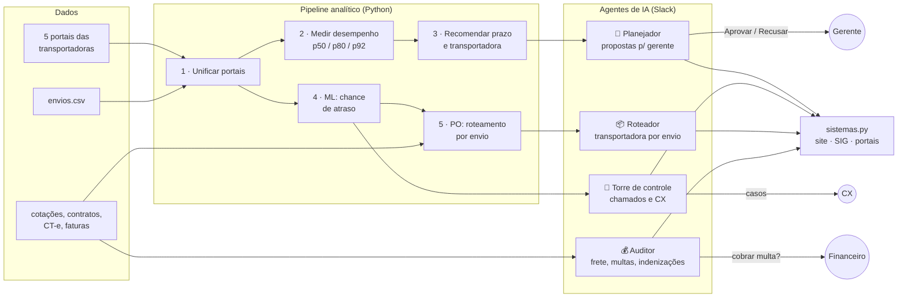

# 🚚 Agente de Transportes — prazo que vende sem quebrar o SLA

> Projeto da **GoHacks Talent 2026** · desafio **Transportes** (Gocase)

Um time de agentes de IA que trabalha no Slack como um analista de logística: junta os portais das transportadoras, mede o desempenho real de cada uma por região, propõe o **prazo de entrega exibido no site** e a **melhor transportadora** por CEP, acompanha os envios em andamento e, no fim, **audita o frete e cobra as multas** do contrato.

**A regra de ouro:** *números saem do código, a IA julga e redige.* Nenhum valor exibido é inventado por um LLM (Large Language Model, modelo de linguagem grande).

---

## O problema

- A empresa usa **várias transportadoras**, cada uma com seu próprio portal de rastreio — não há visão única.
- O site promete um prazo por região (prefixo de CEP). **Prazo curto vende mais**, mas se a transportadora não cumpre, vem atraso, contato no SAC, cancelamento e cliente que não volta.
- O **SLA** (Service Level Agreement, acordo de nível de serviço) do contrato raramente bate com a entrega real, e as faturas de frete nunca descontam as multas por atraso.

**Meta:** 92% das entregas no prazo prometido, com o menor prazo possível.

## A solução em uma imagem



## Os 4 agentes

| Agente | Arquivo | Quando roda | Faz sozinho | Passa para uma pessoa |
|---|---|---|---|---|
| 🧭 **Planejador de prazos** | `nucleo.py` + `3_recomendar.py` | Segunda 08:00 ou `@agente-transportes rodar` | Mede, recomenda, classifica o caso com o Jev, redige a proposta | Gerente aprova/recusa (máx. 12 propostas por ciclo) |
| 🗼 **Torre de controle** | `torre.py` | Dia útil 09:00 ou `torre` | Abre chamado por envio atrasado/sem evento (até 80/dia), abre incidente quando o Jev vê problema sistêmico | CX responde clientes; operação do CD reemite etiquetas |
| 📦 **Roteador de envios** | `5_rotear_envios.py` | Dia útil 09:00 ou `rotear` | Escolhe a transportadora de cada envio antes da postagem | — (respeita o limite de 40% fora da padrão por UF/dia) |
| 💰 **Auditor de frete** | `auditoria.py` | Segunda, após as propostas, ou `auditoria` | Confere CT-e e faturas, calcula multas, abre indenizações que faltam | Financeiro aprova a cobrança; CX recorre das negadas por foto |

### Os dois "cérebros" de IA

Todos os agentes usam o **AI Proxy** do evento (`ia.py`) com dois modos:

- **Chat (GPT, modelo `latest`)** — redige as propostas para o gerente e responde perguntas livres do time no Slack usando *function calling* (ferramentas `consultar_desempenho` e `listar_propostas`), sempre lendo os números dos arquivos.
- **Jev (`/v1/systemone`)** — decisões estruturadas e rápidas com probabilidade: classifica o tipo de problema de uma proposta (`prazo_irreal`, `folga_excessiva`, `transportadora_ruim`) e julga se os atrasos de uma transportadora numa UF são **sistêmicos** (vira incidente formal).

Toda chamada registra tokens e custo em `saida/custos_ia.csv`.

Detalhes em [`docs/AGENTES.md`](docs/AGENTES.md).

## A lógica, etapa por etapa

| Etapa | Arquivo | O que faz | Técnica |
|---|---|---|---|
| 1 | `1_unificar_portais.py` | Junta os 5 portais num formato único e liga cada envio à entrega real | Limpeza e *join* de códigos de rastreio |
| 2 | `2_medir.py` | Desempenho por transportadora × prefixo de CEP: % no prazo, p50/p80/**p92** | Percentis em dias úteis (com feriados) |
| 3 | `3_recomendar.py` | Prazo ideal = p92 real; impacto em R$/mês = ganho de vendas − custo de atrasos − diferença de frete | Modelo econômico (conversão × ticket × margem) |
| 4 | `4_modelo_atraso.py` | Probabilidade de cada envio atrasar | ML — `HistGradientBoostingClassifier` |
| 5 | `5_rotear_envios.py` | Transportadora ótima por envio | PO — programação inteira (HiGHS via `scipy.optimize.milp`) |

Fórmulas, regras de decisão e validação em [`docs/LOGICA.md`](docs/LOGICA.md).

## Resultados de exemplo (dados do desafio)

- **Proposta P01 (SP, ViaLog):** prazo exibido de 5 → 2 dias úteis mantendo 96,5% no prazo — ganho estimado de **R$ 144 mil/mês** em vendas. *(saida/propostas.csv)*
- **Proposta P02 (PA, TransNorte):** prazo de 10 → 18 dias — hoje só 23% chegam no prazo; com o ajuste, 93%. *(saida/propostas.csv)*
- **Torre:** incidentes sistêmicos abertos para Expressa Já (BA, CE) e TransNorte (PA), com probabilidade do Jev entre 71% e 83%. *(saida/incidentes.csv)*
- **Modelo de atraso:** nos 10% de envios com maior risco previsto, 16,2% atrasaram de fato — mais que o dobro da média (7,2%). AUC (Area Under the Curve) 0,648. *(saida/modelo_atraso_relatorio.txt)*

## Arquitetura do código

```
config.py          parâmetros de negócio (meta 92%, custo de atraso, feriados, janela de medição)
ia.py              acesso ao AI Proxy: chat() e jev(), com registro de custo
1_…5_*.py          pipeline analítico (dados → métricas → recomendação → ML → otimização)
nucleo.py          núcleo do agente, independente de canal: estado, Jev, redação, aplicação, respostas
torre.py           torre de controle (envios em andamento)
auditoria.py       auditoria de frete, multas e indenizações
mensagens.py       cards do Slack no padrão "entende em 20 segundos"
sistemas.py        ÚNICA camada que age em sistemas externos (hoje simulada)
agente_slack.py    o agente no Slack (Socket Mode, botões, agendador)
agente.py          versão alternativa no Telegram
```

`sistemas.py` isola todas as ações externas (site, SIG/ERP, portais, financeiro). Hoje grava em `saida/`; para ir à produção basta trocar o corpo das funções pelas APIs reais — o resto do agente não muda.

## Como rodar

```bash
pip install -r requirements.txt
cp .env.example .env            # preencha AI_PROXY_API_KEY e os tokens do Slack
python configurar_e_testar.py   # testa o AI Proxy

# coloque os CSVs do desafio em ./dados  (envios.csv, portal_*.csv, politicas.csv, …)
python 1_unificar_portais.py && python 2_medir.py && python 3_recomendar.py
python 4_modelo_atraso.py && python 5_rotear_envios.py

python agente_slack.py          # ou iniciar_agente.bat no Windows
```

Para criar o app no Slack, use `slack_manifest.yaml` (Socket Mode, sem servidor público).

> Os dados do desafio e a pasta `saida/` não estão no repositório.

## Princípios de projeto

1. **Números do código, julgamento da IA.** O LLM nunca calcula; recebe os números prontos e só redige ou classifica.
2. **Humano no circuito onde há dinheiro ou risco.** Mudar prazo no site → gerente. Cobrar multa → financeiro. Chamado operacional → automático.
3. **Evidência mínima.** Só vira proposta com ≥ 30 envios medidos e ganho ≥ R$ 5 mil/mês; o resto fica "em observação".
4. **Mensagens de 20 segundos.** Ação primeiro, antes → depois, risco de não fazer, detalhe técnico só no botão 🔍.
5. **Pronto para produção por troca de camada.** Toda integração externa passa por `sistemas.py`.
