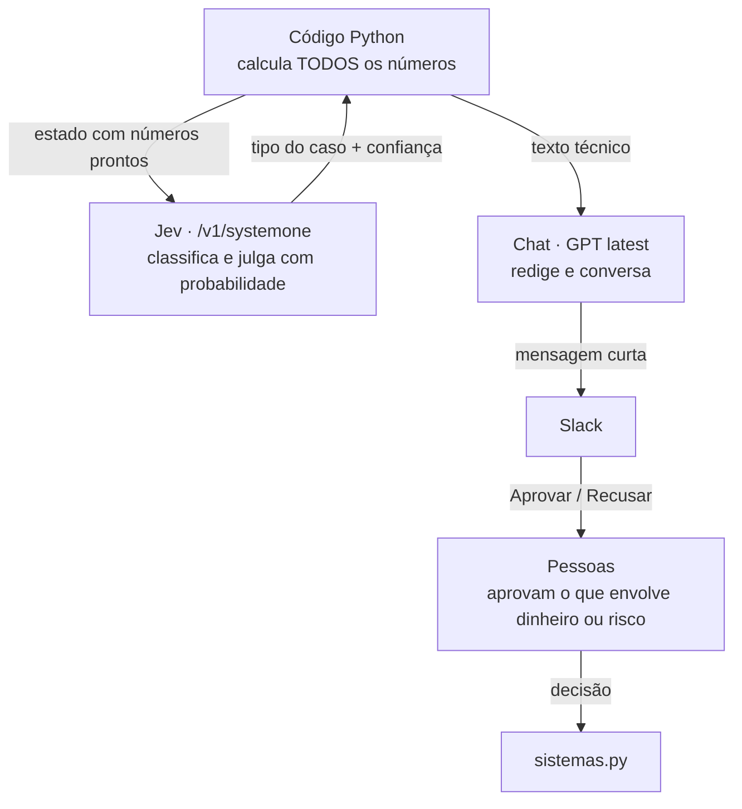

# Agentes de IA

## Divisão de trabalho

O nível de confiança de cada proposta (alta / média / baixa) e os riscos são calculados pelo código (`nucleo.avaliar_risco`), não pela IA. Se o Jev ou o chat estiverem fora do ar, o agente segue com o texto técnico.

## 1. Planejador de prazos — `nucleo.py`

Ciclo (segunda 08:00 ou `@agente-transportes rodar`):

1. Roda as etapas 1 → 3.
2. **Jev** classifica cada proposta:
   - `prazo_irreal` — o site promete menos do que a entrega real leva;
   - `folga_excessiva` — quase 100% no prazo e dá para prometer menos;
   - `transportadora_ruim` — troca porque a atual entrega abaixo da meta.
3. O código avalia os riscos: margem pequena sobre a meta, prazo acima dos concorrentes, transportadora nova pouco medida (< 50 envios), aumento de prazo ≥ 5 dias.
4. **Chat** redige a proposta em até 9 linhas, só com os números recebidos.
5. Posta no Slack com **Aprovar / Recusar / 🔍 Detalhes**. Só quem está em `SLACK_GERENTES` aprova.
6. Aprovada → `sistemas.atualizar_regra_site()` e registro em `saida/acoes.csv`.

Propostas têm identidade pelo conteúdo (`assinatura`): os mesmos prefixos com o mesmo prazo e transportadora não são propostos de novo.

### Perguntas livres

Quem menciona `@agente-transportes` ou manda DM recebe resposta do chat com *function calling*:

| Ferramenta | Retorna |
|---|---|
| `consultar_desempenho(transportadora, uf, prefixo)` | linhas de `saida/desempenho.csv` |
| `listar_propostas()` | situação das propostas |

Formato obrigatório: 1ª linha com a resposta e ícone (🔴 abaixo de 92%, 🟡 perto, ✅ acima), no máximo 3 linhas, fonte citada.

## 2. Torre de controle — `torre.py`

Todo dia útil 09:00 ou `torre`. Detecta problemas por envio, abre chamados sozinho, separa casos para o CX e a operação do CD, e usa o **Jev** (pergunta do tipo sim/não com probabilidade) para decidir se um conjunto de atrasos é sistêmico.

## 3. Roteador de envios — `5_rotear_envios.py`

Todo dia útil 09:00 ou `rotear`. Combina o modelo de ML (chance de atraso) com otimização inteira para escolher a transportadora de cada envio ainda não postado.

## 4. Auditor de frete — `auditoria.py`

Toda segunda depois das propostas ou `auditoria`. Confere CT-e e faturas, calcula multas não descontadas, abre indenizações que faltam e pede ao financeiro a aprovação para cobrar.

## Mensagens (`mensagens.py`)

Padrão "bate o olho e entende em 20 segundos":

1. Começa pela **ação** (verbo + o quê).
2. Benefício em números, **antes → depois**.
3. Risco de não fazer (⏳).
4. Urgência por ícone: 🔴 urgente · 🟠 importante · 🟡 oportunidade · ✅ feito · ⚠️ cuidado.
5. Detalhe técnico só no botão 🔍 (abre na thread).

Os textos dos cards são montados pelo código a partir dos números.

## Comandos no Slack

| Comando | Ação |
|---|---|
| `@agente-transportes rodar` | ciclo de propostas agora |
| `@agente-transportes pendentes` | repostar propostas sem decisão |
| `@agente-transportes torre` | torre de controle agora |
| `@agente-transportes rotear` | roteamento por envio agora |
| `@agente-transportes auditoria` | auditoria de frete agora |
| `@agente-transportes status` | situação geral |
| qualquer outra frase | pergunta livre ao chat |

## Custos de IA

Cada chamada imprime uma linha `💲 modelo · entrada · saída · US$` e grava em `saida/custos_ia.csv`.
